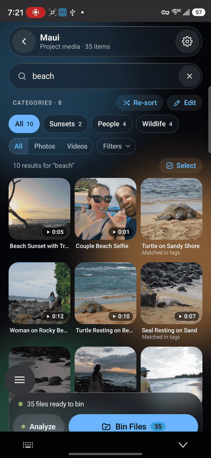

# Agentic Binning

**Your photos and videos, understood and sorted by an AI that lives on your phone.**

If you shoot a lot of photos and video — trips, family events, video projects — you know the problem: a folder full of files named `20260924_133728.jpg`, and no easy way to remember what's what or find anything later. Agentic Binning fixes that. You point it at a project folder, and an AI model running entirely on your phone's NPU looks at every photo and video, gives each one a plain, friendly name (like "Sea Turtle Swimming"), writes a short description, and tags it with a category and shot type. When you're ready, tap **Bin Files** and everything is moved into tidy category folders — Sunsets, Wildlife, Waves, and so on. Later, you can search your whole project with a word like "turtle" and get matching media instantly. Your photos and videos never leave your phone: the AI runs on-device, so it works offline, it's fast (about 32 tokens per second), and your media stays yours.

## See it in action

<p>
  
  
</p>

*Left: the local model scanning each file and writing its description, live on the NPU. Right: browsing the sorted project and filtering by category.*

## How it works

1. **Pick a project folder** on your phone — a trip, a shoot, an event.
2. **Tap Analyze.** The app looks at each photo and video with a vision model (Liquid AI's LFM3-VL-2B) running on the Snapdragon NPU through GenieX. For each file it writes a friendly name, a short description, tags, a category, and a shot type.
3. **Browse, search, and filter** by category, keyword, or photo vs. video.
4. **Tap Bin Files.** The app moves every file into a subfolder named for its category, so the folder on disk ends up organized the same way it looks in the app.

The first time you analyze something, the app downloads the model from Hugging Face. After that, analysis is fully on-device and works with no connection at all.

### Optional: cloud help with sorting

The local model always does the looking — that part never changes. If you want sharper categories, you can optionally let a cloud model (Claude, by Anthropic) help with the *categorizing and sorting* step. It works only from the text the local model already wrote — the names, descriptions, and tags for each file — and uses that text to improve the accuracy of the categories.

**Your photos and videos are never sent to the cloud.** Only those short text summaries are, and only if you turn the feature on and supply your own Anthropic API key. With it off, nothing leaves the phone at all.

## What you need

- A phone with a **Snapdragon 8 Elite Gen 5** or **Snapdragon 8 Elite Gen 6** — the on-device model runs on these chips' NPU, and only these. Other devices are not supported at this time.
- A Wi-Fi or data connection the first time you analyze, so the app can download the model. After that, analysis is fully offline.
- A project folder of photos and/or videos to sort.

## Verified devices

Agentic Binning has been developed and tested on:

- **Samsung Galaxy S26 Ultra**

Other phones with a Snapdragon 8 Elite Gen 5 or Gen 6 should work, but they haven't been verified yet. If you try one, please report how it went.

## Getting the app

Prebuilt APKs are attached to each release on the [Releases](../../releases) page. Download the APK, open it on your phone, and allow installing from your browser/files app when Android asks.

Or build it yourself — see below.

## Building from source

You need:

- **JDK 17**
- The **Android SDK** (the project targets SDK 35), with `ANDROID_HOME` set or a `local.properties` file pointing at it

Then:

```bash
git clone https://github.com/jdtimothy/Agentic-Binning-Android.git
cd Agentic-Binning-Android
./gradlew assembleDebug
```

The debug APK lands in `build/outputs/apk/debug/`. Dependencies — including the GenieX Android library — are pulled from Maven Central and Google's Maven repo automatically. No model files are in this repository; the app downloads its model at runtime.

Release builds are made by GitHub Actions: pushing a version tag (for example `v1.0.0`) builds the release APK and attaches it to a GitHub Release.

## Versioning

This project uses [Semantic Versioning](https://semver.org/): `MAJOR.MINOR.PATCH`.

- **MAJOR** — big changes that rework how the app behaves or handles your projects
- **MINOR** — new features that don't break anything existing
- **PATCH** — bug fixes

The version lives in `build.gradle` (`versionName` / `versionCode`), releases are tagged `vX.Y.Z` in git, and changes are listed in [CHANGELOG.md](CHANGELOG.md).

## Privacy, in plain terms

- Analysis happens entirely on your phone. Your photos and videos are never uploaded, tracked, or phoned home — not by the local model, and not by the optional cloud feature either.
- The app asks for access only to the folders you pick.
- The optional cloud sorting help is off by default and uses your own API key. If you turn it on, the only thing sent is the text the local model wrote (names, descriptions, and tags) — never your actual photos or videos.

## License

This project's own code is released under the [MIT License](LICENSE).

The app is built on other people's work, some of it under different terms — most importantly Qualcomm's GenieX (BSD 3-Clause) and the QNN / AI Engine Direct runtime libraries inside it (Qualcomm's AI Runtime SDK EULA), plus the LFM3-VL model (LFM Open License v1.0, downloaded at runtime, not distributed with the app). Please read [THIRD_PARTY_NOTICES.md](THIRD_PARTY_NOTICES.md) before redistributing builds.

## Credits

- [Qualcomm GenieX](https://github.com/qualcomm/GenieX) — on-device inference
- [Qualcomm AI Hub Apps](https://github.com/qualcomm/ai-hub-apps) — sample apps this project learned from (the image classification Android sample was the starting point)
- [Liquid AI](https://huggingface.co/LiquidAI/LFM3-VL-2B) — the LFM3-VL-2B vision-language model
